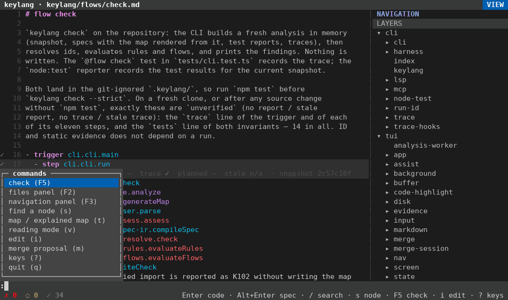
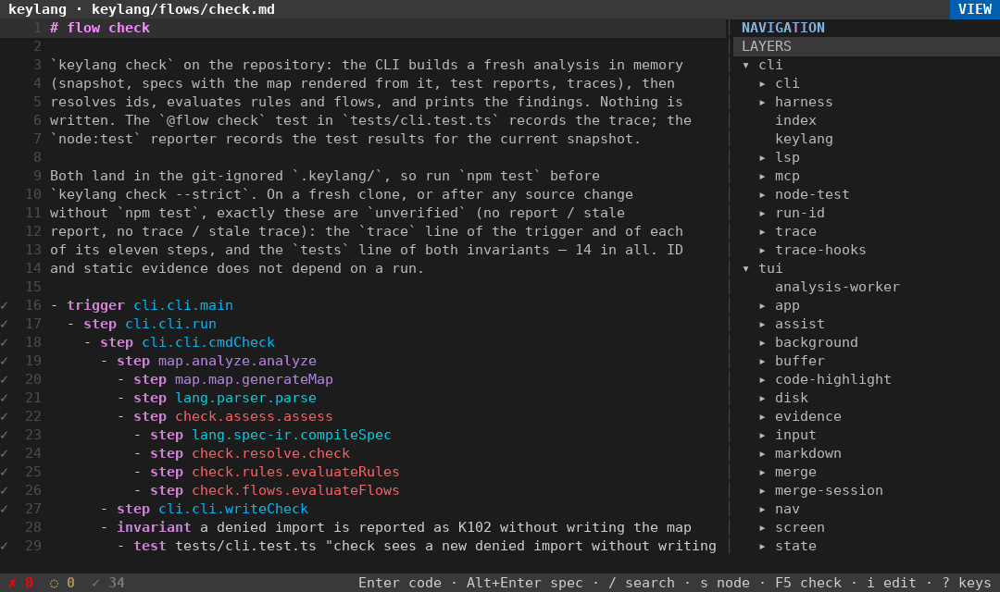
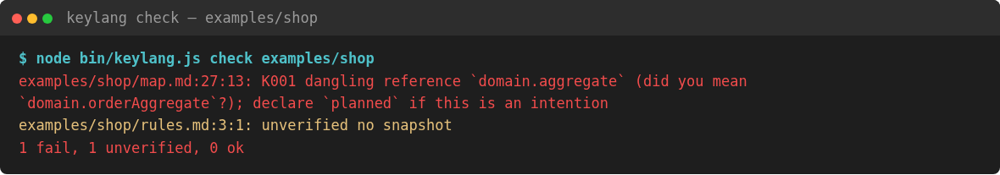
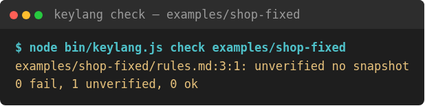
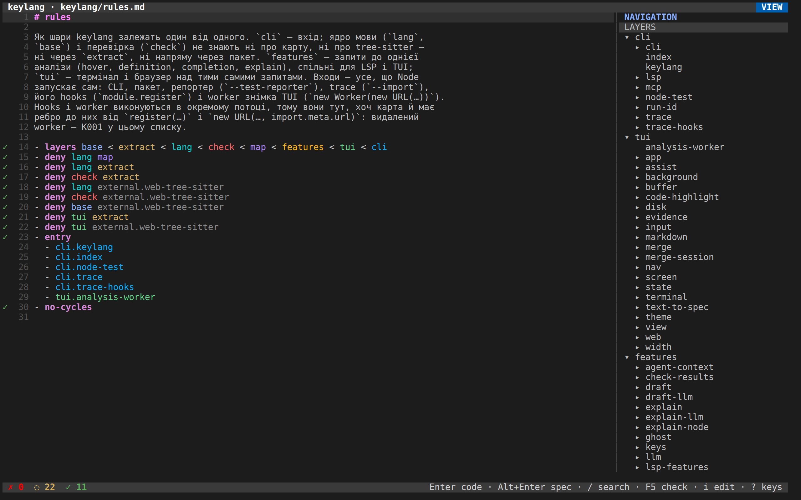
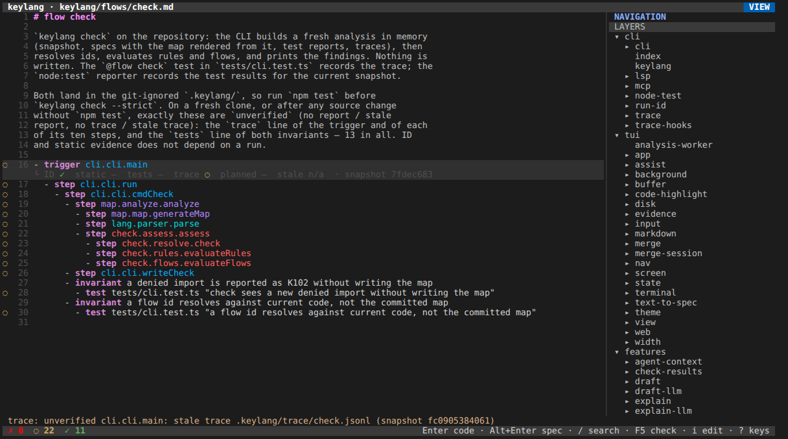
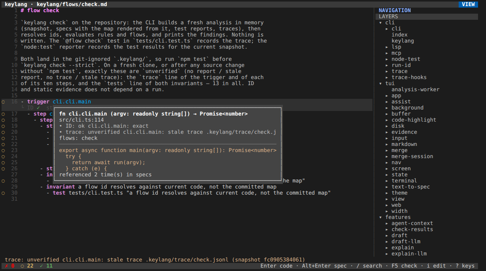

# keylang

[English](README.md) · **Українською**


keylang — це Markdown, що лежить поруч із кодом. У ньому ви пишете специфікацію: яким частинам програми дозволено знати одна про одну і які сценарії мають і далі працювати. Самих функцій ви не пишете: код за цією специфікацією генерує агент. Агента keylang теж не запускає. Його робота — перевіряти, що згенерований код і далі відповідає специфікації.

Для прикладу візьмімо інтернет-крамницю. Екран починає покупку, а покупка просить правила замовлення зібрати замовлення. Самі правила замовлення нічого не знають ні про екран, ні про базу даних. Це останнє речення і є правилом, і keylang уміє його стерегти: якщо код його порушить, перевірка може зупинити збірку.

Ось як це виглядає в терміналі. Наберіть `:`, потім `rules` і натисніть Enter — курсор спуститься до рядків `deny`:



`/` шукає `cli.cli.main`. Рядком нижче `K` відкриває функцію, що стоїть за цим кроком:



`?` показує всі клавіші, а Esc знову закриває список:


Ці ролики знято одразу після `npm test`. Trace із того запуску збігається з кодом, тож неперевіреного не лишилося, і рядок стану показує `✗ 0  ◌ 0  ✓ 34`.

Якщо ці слова для вас нові, почніть із [підготовчого курсу](docs/course/pre/uk/README.md) ([English](docs/course/pre/README.md)). Основний посібник — [курс](docs/course/uk/README.md) ([English](docs/course/README.md)). Якщо ви хочете додати фічу до репозиторію, який уже існує, ідіть [цим маршрутом](docs/course/existing/uk/README.md) ([English](docs/course/existing/README.md)); а якщо починаєте з нуля Telegram-бота, CRUD на Python чи застосунок на NestJS — [цим](docs/course/from-scratch/uk/README.md) ([English](docs/course/from-scratch/README.md)).

Для довідки: точна граматика описана в [`docs/format.md`](docs/format.md), а команди — у [`docs/tools.md`](docs/tools.md). Агент може встановити keylang за файлом [`llm.txt`](llm.txt) ([сирий файл](https://raw.githubusercontent.com/Ivlad003/keylang/master/llm.txt)), де також сказано, для чого keylang варто використовувати, а для чого ні. Куди рухається проєкт, разом із тим, чого інструмент ще не вміє, описано в [`docs/design.md`](docs/design.md).

Потрібен Node.js ≥ 22.18. У клоні цього репозиторію `node bin/keylang.js` виконує вихідний TypeScript напряму, без збирання. Опублікований пакет натомість містить звичайний JavaScript: перед публікацією `prepack` компілює `src/` у `dist/`. В обох випадках під час встановлення на вашій машині native-код не компілюється.

## Що ви пишете

| Файл | Хто пише | Що це |
|---|---|---|
| `keylang/map/*.md` | `keylang map` | Шари, модулі й функції з посиланнями на рядки коду. Файл генерується, тож не редагуйте його |
| `keylang/rules.md` | ви | Хто від кого може залежати: `layers`, `allow`, `deny`, `entry`, `exports`, `no-cycles` |
| `keylang/flows/*.md` | ви | Один сценарій на файл. Кожен крок окремо звітує `ID`, `static`, `tests` і `trace` |
| `keylang/features/*.md` | ви | Що будувати далі. `keylang feature <slug>` підкаже, коли роботу завершено |
| `keylang/flows-discovered/` | `keylang flows discover` | Чернетка потоку для кожної точки входу. Згенероване представлення, яке `check` не читає |
| `keylang/diagrams/*.layout.json` | редактор діаграм | Де стоять фігури діаграми. Його комітять, щоб команда бачила ту саму картинку; `check` його не читає |
| `keylang/migration.md` | ви або `keylang flow import` | Яке ID старого стеку стало яким ID тут, коли систему переносять на інший стек |
| `.keylang/proposals/` | агент | Чернетка змін до специфікації, яку людина зливає частинами |
| програма | агент | Функції, згенеровані зі специфікації. Ви їх не пишете, а keylang агента не запускає |

Специфікація посилається на код за іменем. Ім'я виглядає як `application.purchase.buy` і по черзі називає шар, модуль і функцію. Це не номер рядка, тому специфікація лишається чинною, коли правки лише зсувають код вище чи нижче.

Якщо в `keylang.json` стоїть `"explain": {"map": true}`, `keylang map` додатково пише `keylang/map-explained/`. У цій версії карти під кожним вузлом стоїть одне-два речення: або з коментаря в коді, або зі збереженої нотатки, у якій записано, яка модель її написала і коли.

## Три відповіді

Кожна перевірка закінчується однією з трьох відповідей:

- `ok` — твердження справдилося всюди, куди keylang зазирнув.
- `fail` — keylang знайшов і показав конкретне порушення. Код виходу — 1.
- `unverified` — ні те, ні інше: keylang натрапив на дірку, відсутній файл або застарілий trace, тож вирішити не зміг. Це не успіх, і `--strict` перетворює такий результат на код виходу 1.

Коди виходу такі: `0` — нічого не блокує, `1` — порушення (сюди належить і застаріла карта з `map --check`, і будь-який `unverified` з `--strict`), `2` — неправильний виклик або помилка файла. Щоб машинний вивід лишався чистим, `parse --json` пише в stdout лише JSON, а `check` пише знахідки в stdout, а підсумок — у stderr.

Так само важливо знати, чого keylang не робить. Він не вирішує, чи програма правильна, безпечна або завершена, а його межі такі:

- Речення під вузлом — це проза. keylang його зберігає, але не доводить.
- Виклик, який keylang не може статично назвати (`obj[k]()`, невідомий декоратор, `eval`), — це дірка, тож відповідь для нього лишається `unverified`.
- Для Rust і Python keylang записує імпорти й виклики, але не ребра типів.
- Для PHP він записує імпорти, виклики й типи з type hints і docblock-ів. Виклик через інтерфейс лишається діркою, якщо реалізацію не називає адаптер фреймворку (`<preference>` Magento, прив'язка Laravel чи Symfony).
- Wiring генерує TypeScript-функцію `wire()`, але не забороняє решті програми імпортувати що завгодно. Ловити такі імпорти — і далі завдання правил.
- keylang читає вже наявні звіти тестів і trace. Сам він не запускає тести, не перевіряє типи й не робить рев'ю безпеки.
- Go, Java, Ruby та інших мов у знімку просто немає. Їхня відсутність не доводить, що вони ні від чого не залежать.

## Спробуйте

```sh
npx keylang init .      # вгадати шари, записати keylang.json, зібрати карту
npx keylang check       # імена і правила в keylang/
npm i -g keylang        # далі просто `keylang …`
npx keylang clone https://github.com/owner/repo   # чужий репозиторій: клон у кеш і карта
npx keylang web https://github.com/owner/repo     # те саме, потім інтерфейс у браузері
npx keylang web --new shop                         # новий проєкт з діаграми, у браузері
npx keylang web --hub                              # стартова сторінка: викачати репозиторій за URL, відкрити теку з ПК
npx keylang system discover                        # система коду: сервіси, бази, черги, послідовності
npx keylang system new chat --interview            # системний дизайн, який можна малювати й перевіряти: компоненти, схема, sequence
npx keylang web --read-only                        # лише читання: карта, пояснена карта, діаграми; нічого не пише
npx keylang web --export site                      # те саме статичним сайтом, без сервера
docker run --rm -p 127.0.0.1:7070:7070 -v "$PWD":/work:ro ivlad003/keylang web --read-only --host 0.0.0.0
```

З клону цього репозиторію:

```sh
npm install
node bin/keylang.js map                  # переписати keylang/map/*.md і .keylang/index.json
node bin/keylang.js map --check          # CI: код 1, коли карта застаріла
node bin/keylang.js check                # нічого не пише
node bin/keylang.js check --strict       # unverified стає порушенням
node bin/keylang.js explain K001         # що означає код і як виправити
node bin/keylang.js                      # інтерфейс у терміналі (? — клавіші, q — вихід)
node bin/keylang.js web                  # той самий інтерфейс у браузері; відкрийте надрукований URL
```

`keylang web` віддає ще й сторінку діаграм (`/diagrams`, посилання на неї є на сторінці терміналу). У списку з пошуком лежать флоу, знайдені флоу, точки входу й шари. Вибраний пункт малюється діаграмою на кшталт BPMN: окрема доріжка на кожен шар, кольори показують вердикти. Клікніть крок, і бічна панель покаже його ID, `file:line` (посилання `vscode://`), вердикти та де ще вживається цей ID. Дослідник проходить виклики точки входу ще до того, як з'явиться флоу, а «Сліпі зони» показують звіт `coverage`. Вкладка редактора малює вид так, як diagrams.net: з undo/redo, експортом у PNG і SVG та копіюванням і вставленням між вкладками й проєктами. Розкладка зберігається в `keylang/diagrams/`. Кнопка «Запропонувати зміни» не править специфікації, а перетворює малюнок на пропозиції до них. `keylang web --new <тека>` починає новий проєкт з порожнього полотна ([docs/tui.md](docs/tui.md#сторінка-діаграм-diagrams)). Якщо репозиторій треба показати, не змінюючи його, `keylang web --read-only` віддає лише сторінку діаграм із вкладкою «Карта», де лежать карта й пояснена карта, і нічого не записує. `keylang web --export <тека>` записує ті самі сторінки статичним сайтом, який відкривається навіть з `file://`, а поруч кладе `app.html`, що аналізує теку, перетягнуту в браузер, без жодного сервера ([docs/tui.md](docs/tui.md#viewer)).


У `examples/shop` навмисно залишено хибний ID `domain.aggregate`, щоб ви побачили помилку. Знімка коду в прикладі теж немає, тож і потік довести не вдається. Перевірка завершується кодом 1:



В `examples/shop-fixed` цей ID виправлено. TypeScript у цій теці все одно немає, тож правила лишаються `unverified` (`no snapshot`), але нічого не падає, і перевірка завершується кодом 0:



Скриншоти нижче показують `node bin/keylang.js web` на цьому репозиторії станом на 2026-09-28. Тоді локальний trace і звіт `node:test` були старіші за знімок коду, тому позначки, які від них залежать, мають `unverified`. Це чесний результат, а не помилка. Числа у двох поданнях теж різняться, і недарма: рядок стану рахує рядки (кожен рядок отримує свою найгіршу позначку), а `keylang check` рахує кожен окремий доказ. Тому той самий запуск друкує `0 fail, 22 unverified, 43 ok`, а інтерфейс показує `✗ 0  ◌ 22  ✓ 11`. Ролики на початку сторінки зняті під час пізнішого запуску.

Це правила самого цього репозиторію. Вони кажуть, що ядро мови (`lang`, `base`) і перевірка не повинні залежати ні від екстрактора, ні від tree-sitter:



А це потік `check`. Його ID розв'язується точно, а статичного батьківського виклику, який треба було б доводити, немає. Зате файл trace лишився від старішого знімка:



Клавіша `K` або наведення мишею показує сигнатуру функції, її файл і перші кілька рядків оголошення:



Більше скриншотів — у [восьмому уроці курсу](docs/course/uk/08-use-cases.md).

## Як зануритися в чужий проєкт

Щоб розібратися в незнайомому репозиторії, вистачить кількох команд. Модель їм не потрібна, а пишуть вони лише згенеровані представлення й локальний кеш:

```sh
keylang entries          # звідки починається виконання: маршрути, cron, консюмери, observers, bin-скрипти, main
keylang flows discover   # чернетка флоу для кожної точки входу в keylang/flows-discovered/
keylang coverage         # сліпі зони: до чого не доходить жодна точка входу, дірки за модулями, логіка в даних
keylang integrations     # з чим говорить код: клієнти HTTP, SOAP, SDK і черг, вебхуки
keylang tour             # одна сторінка: система, шари, процеси, інтеграції, сліпі зони, з чого почати читати
keylang web              # ті самі флоу діаграмами; вкладка «Огляд» — це тур
```

`keylang tour --out keylang/tour.md` зберігає сторінку як згенерований файл, який `check` не читає. `--json` дає ті самі дані, а агенти отримують їх через інструмент MCP `project_tour`. `keylang flows adopt <назва>` робить з одного знайденого флоу пропозицію специфікації. Докладно — [`docs/cli.md`](docs/cli.md#tour).

Флоу можуть і вийти з keylang, і повернутися: `keylang export bpmn <флоу>` пише BPMN 2.0 з діаграмою, `keylang export drawio <вид>` — файл draw.io, а `keylang import drawio <файл>` перетворює змінений малюнок на одну пропозицію ([`docs/cli.md`](docs/cli.md#export-bpmn)). Коли систему переносять на інший стек, `keylang flow export` пакує її бізнес-флоу в один Markdown-файл, `keylang flow import` пропонує їх у новому репозиторії як кроки `planned`, а `keylang migration status` порівнює кожен старий флоу з його відповідником: чи збігаються кроки і чи ті самі тести проходять з обох боків ([`docs/cli.md`](docs/cli.md#migration)).

## Мови й фреймворки

keylang читає TypeScript, JavaScript, Python, Rust і PHP. Адаптер фреймворку перетворює на факти те, що фреймворк виконує зі своєї конфігурації: прив'язки залежностей, маршрути, події та їхні observers, cron-задачі й консюмери черг. Адаптери є для Magento, Salesforce Commerce Cloud (SFRA) і PWA Kit, Laravel, Symfony, NestJS, Django, FastAPI, Flask, Celery, Express, Fastify і Next.js. Кожен вмикається сам, коли маніфести чи код називають його фреймворк, а `frameworks` у `keylang.json` це перевизначає ([`docs/snapshot.md`](docs/snapshot.md)).

## Чого це коштує

Граматика займає невелику частину Markdown, і кожне слово означає те, що дозволяє йому батьківський рядок. Повноцінний блок коду всередині пункту списку не підтримується. Якщо `keylang fmt` не може довіряти вкладеності файла, він відмовляється його переформатовувати, тож після `fmt` те, що показує GitHub, і те, як файл розуміє `check`, і далі збігаються.

Коли модуль перейменовують або переносять до іншого шару, імена доводиться оновлювати вручну. Пам'ятайте також, що карта показує лише модулі й залежності. Розгортання, структуру даних і причини рішень і далі описують прозою або в ADR.

І нарешті, код виходу 0 означає лише те, що нічого не блокує. Без `--strict` запуск може завершитися кодом 0, навіть коли частина відповідей — `unverified`.

## Що це за мова

keylang — це структурований список, а не мова програмування. У ньому немає змінних і циклів, тож будь-який файл можна прочитати від початку до кінця, нічого не запускаючи. Хибний рядок отримує код діагностики (K001–K302), а розбір іде далі. Що означає кожен код, пояснює `keylang explain`.

Мова виросла з Markdown-форми архітектурної мови Тимура Шемсединова. Як вона співвідноситься з import-linter, ArchUnit, Structurizr та подібними інструментами, розповідає [`docs/archive/research-pl.md`](docs/archive/research-pl.md).

## Що вже є

Нижче — короткий перелік етапів; подробиці — у [`docs/design.md`](docs/design.md) §9.

- **M0.** Формат, парсер, імена, що розв'язуються між файлами, коди K001–K006 і `fmt`. Ядро мови не імпортує tree-sitter.
- **M1.** Карта й правила для TypeScript і JavaScript із кодами K101–K105. `keylang check` на самому цьому репозиторії порушень не знаходить.
- **M2–M3.** Потоки з доказами `ID`, `static`, `tests` і `trace`, а також вузли `planned` (K201, K202). CLI, LSP, MCP та інтерфейс спираються на один і той самий аналіз. Тонкий клієнт для VS Code лежить у `editors/vscode/`; у Marketplace його не опубліковано, і до npm-пакета він не входить.
- **M4.** Інтерфейс у терміналі, а також той самий інтерфейс у браузері через `keylang web`.
- **M5.** Rust і Python на тому самому графі, з обмеженнями, переліченими вище. Адаптери trace лежать в `adapters/python` і `adapters/rust`, а `keylang trace-plan <flow>` друкує, що саме потрібно інструментувати.
- **M6.** `# wiring` пише типізований `wire()` у `keylang.gen.ts` ([ADR 0003](docs/adr/0003-wiring-lifecycle.md)).
- **M7.** `draft`, `code-to-spec`, `spec-to-code` і `explain <id> --llm` не правлять специфікацію напряму, а пишуть пропозиції. Так само `apply_diff` у `keylang mcp` лише записує пропозицію. Голосове введення — за бажанням (`Ctrl+R`). `keylang doctor` повідомляє про проблеми й нічого не змінює.
- **M8.** `init` і `keylang agents` додають короткий блок в `AGENTS.md`, сервер MCP і skill для Claude Code, Codex, Cursor чи opencode ([ADR 0005](docs/adr/0005-harness-integration.md)). `keylang baseline` пише `keylang/rules.baseline.md` — перелік залежностей між шарами, яких у графі ще немає. `check --changed` і `keylang hook stop` блокують хід агента лише тоді, коли з'являється нове порушення або специфікацію послаблено від останнього коміту (K108: знятий `deny` чи крок, новий `allow`, ширший `exclude` у `keylang.json`). Усе це покрито тестами CLI і MCP, але наскрізно з Claude Code і Codex на сторонньому репозиторії ще не перевірялося.
- **PHP.** Класи, функції, `use` і виклики на тому самому графі ([ADR 0015](docs/adr/0015-php-imports-name-declarations.md)). Пакети composer позначаються як `external.*`, а вбудовані функції й класи самого PHP вузлами взагалі не стають. `spec-to-code` пише заготовку PHP разом із тестом PHPUnit, що поки падає, а в `adapters/php` лежать адаптер trace і розширення PHPUnit.
- **Бізнес-флоу.** Точки входу (`keylang entries`), знайдений флоу для кожної точки входу й бізнес-процеси, які називає модель (`flows discover`, `flows adopt`), представлення `coverage`, `integrations` і `tour`, а також адаптери фреймворків вище ([ADR 0022](docs/adr/0022-framework-facts.md)). У потоках з'явилися групи `parallel`, тригери з видом (`trigger route|cron|consumer|webhook|event`), `continues`, таймери `after` і `every` та `emits event`, який перевіряється проти коду ([ADR 0023](docs/adr/0023-async-flows.md)). Додалися сторінка діаграм і її редактор ([ADR 0024](docs/adr/0024-diagram-editor.md)), експорт у BPMN і draw.io, імпорт з draw.io, пакети флоу й паритет міграції. Trace може йти за одним справжнім запитом: `keylang trace-plan --entry <id>` інструментує те, до чого доходить точка входу, а `draft flow --from-trace` пропонує флоу з того, що побачив запуск ([`docs/cli.md`](docs/cli.md#trace-requests)).
- **Системний дизайн.** `# system <name>` описує систему так, як її малюють на співбесіді: клієнти, балансувальники, сервіси, бази, кеші, черги, зони, зв'язки з протоколом і навантаженням, таблиці з ключами, sequence, вимоги, оцінки й компроміси. Компонент, прив'язаний до коду (`- code <id>`), перевіряється: `api reads db` (postgres) — `ok`, коли з коду `api` імпортами досяжний драйвер postgres. `keylang system discover` виводить ту саму систему з коду: точки входу, імпортовані драйвери, схеми Prisma і SQL, шляхи викликів. Сторінка діаграм малює схему, ER і sequence та редагує їх палітрою ([`docs/cli.md`](docs/cli.md#system), приклад — [`examples/system-interview`](examples/system-interview/url-shortener.md)).

`bench/` запускає інструмент на восьми репозиторіях, а отримані числа зібрано в [`bench/results.md`](bench/results.md); `bench/magento/` міряє адаптер PHP на Magento 2.4.9.

## Тести

```sh
npm test            # node:test, через справжній CLI
npm run typecheck   # tsc --noEmit
```

Інтерфейс у терміналі тестується без справжнього термінала (`tests/tui-*.test.ts`), а `keylang web` — через CLI і WebSocket (`tests/web.test.ts`); сторінку діаграм у headless Chromium запускає `npm run test:web` (до `npm test` не входить).

Щоб опублікувати пакет, почніть із чистого клону: виконайте `npm test && npm run typecheck`, далі `npm version patch` (або minor, або major) і `npm publish`. `prepack` сам збере `dist/`. Перш ніж публікувати, перегляньте архів через `npm pack`.
